# OpenCode mobile

<p align="center">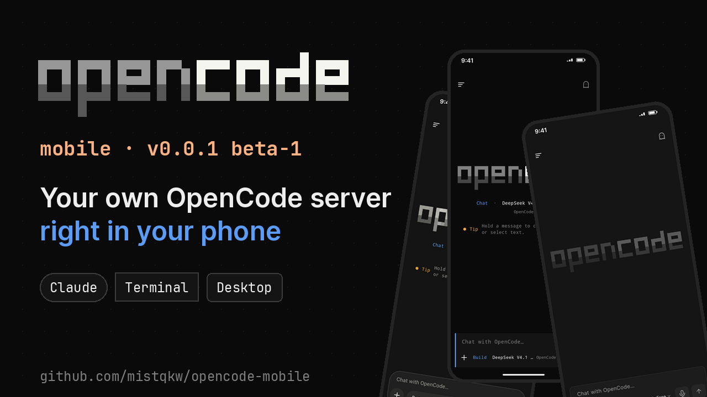</p>

**v0.0.1 beta-1** · Android 8+ (arm64) · неофициальный клиент

Android-приложение, внутри которого живёт **свой сервер OpenCode**: Ubuntu 24.04 в proot + `opencode serve`
на 127.0.0.1. Компьютер не нужен. Можно и наоборот — подключиться к OpenCode на компьютере (Code → Devices).

<p align="center">
  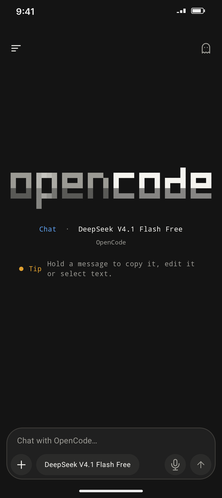
  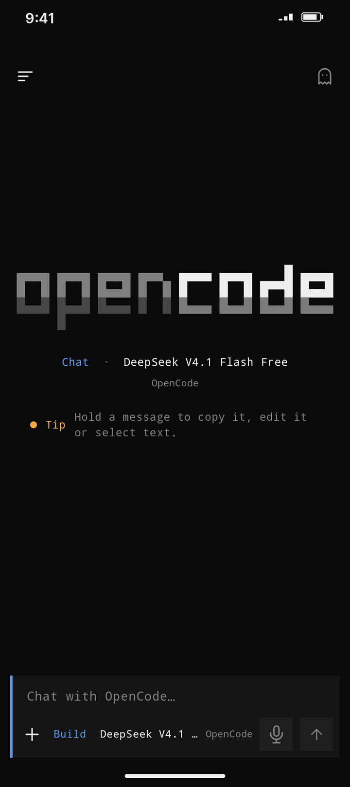
  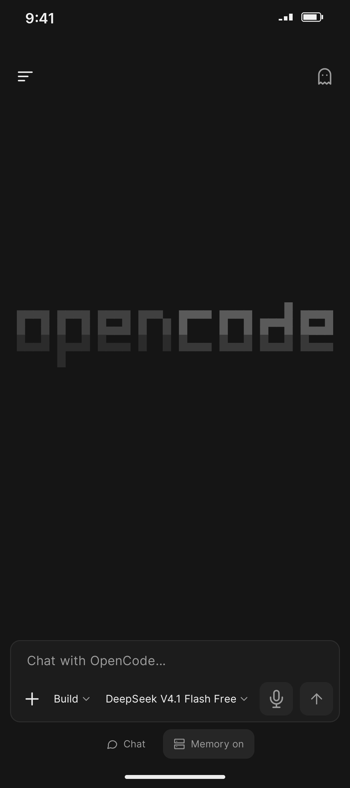
  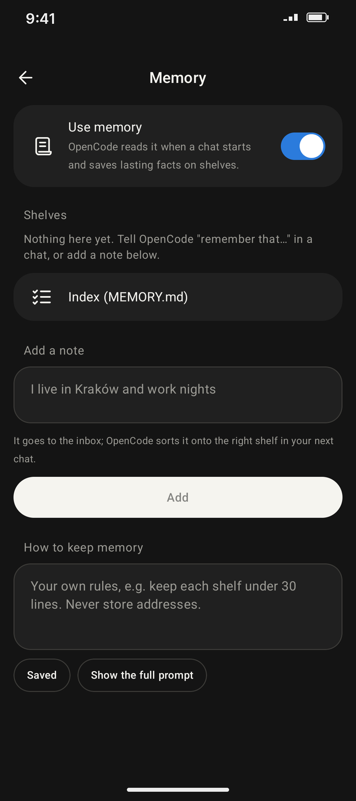
</p>

## Что умеет
- **Три интерфейса** (Settings → Interface): *Claude* — мягкий, как мобильный Claude; *OpenCode · Terminal* —
  моноширинный, прямые углы, синяя полоса у сообщений, как в консоли; *OpenCode · Desktop* — плоские панели,
  Inter, бледно-синий акцент, как в десктоп-приложении. Окна выбора модели и «Add to session» тоже свои в каждом.
- **Чат и Code раздельно.** Обычные чаты живут в `/root/chats`, всё остальное — вкладка Code с проектами.
- **Память.** Агент читает `/root/memory/MEMORY.md` и раскладывает факты по «полкам» (about-me, work, projects…).
  Правила памяти и ручные заметки — Settings → Memory.
- **Лимиты и расход** (5 ч / 7 д / 30 д), картинки в чате, Scheduled, Artifacts, MCP-коннекторы, навыки, права.
- **Вход не пропадает:** копия ключей и памяти лежит вне окружения и переживает его переустановку.
- Пасхалки: нажмите на надпись «opencode» на новом чате.

<p align="center">
  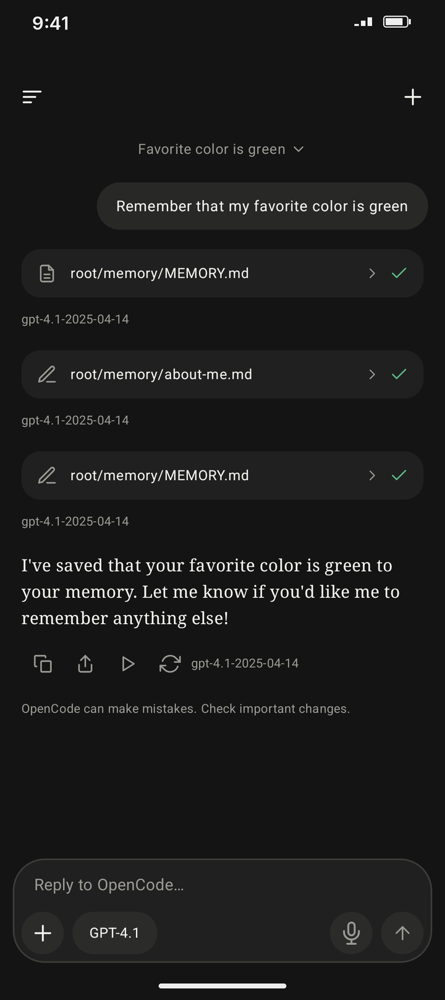
  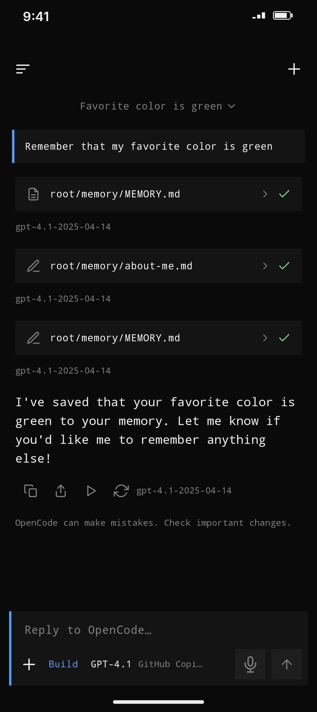
  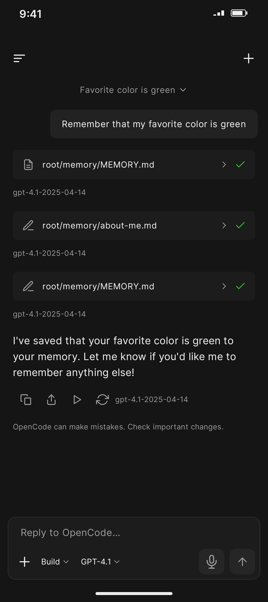
</p>

<p align="center">
  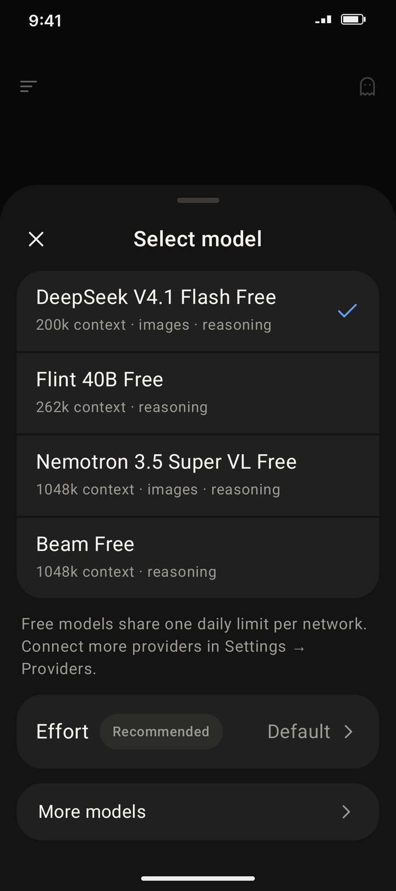
  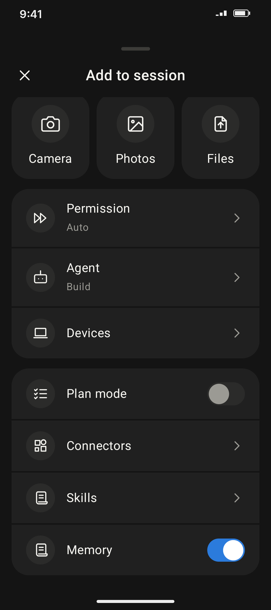
  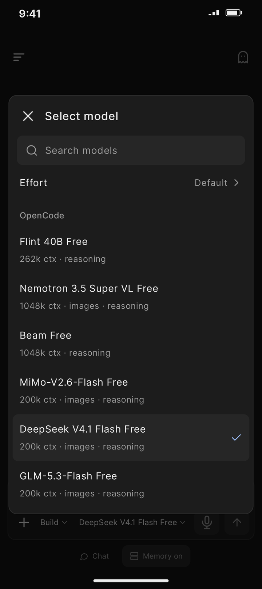
  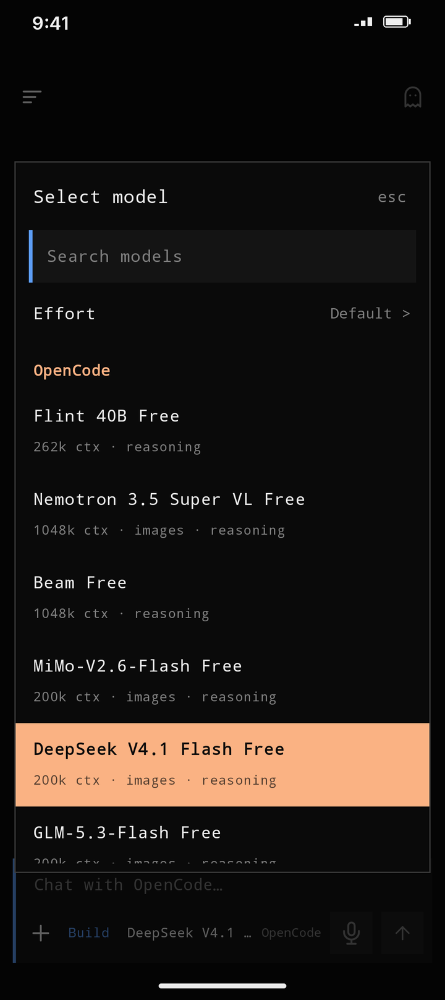
</p>

## Установка
1. Скачайте APK из [Releases](../../releases) и установите (разрешите установку из неизвестных источников).
2. При первом запуске приложение скачает и распакует окружение (Ubuntu Base + OpenCode) — нужен интернет и место.
3. Выберите модель. Встроенные бесплатные модели Zen (OpenCode) ограничены на стороне сервера: лимит считает сам
   сервис, сброс срабатывает не всегда, и этим страдают не только мобильные клиенты (см. issues OpenCode
   [#58830](https://github.com/anomalyco/opencode/issues/58830), [#58814](https://github.com/anomalyco/opencode/issues/58814)).
   Поэтому в приложении есть запасные бесплатные пути (Providers → Free models, а при ошибке лимита — кнопки в чате):
   - **GitHub Copilot** — войти аккаунтом GitHub; доступны GPT-4.1, GPT-4o и GPT-4o mini (то, что реально отвечает на
     бесплатном тарифе Copilot; сервер OpenCode 1.19.4 сам скрывает эти модели, поэтому приложение подключает их как отдельного провайдера);
   - **Pollinations** — вообще без аккаунта, модель GPT-OSS 20B; сообщения уходят на pollinations.ai;
   - свой ключ: Google Gemini, Groq, OpenRouter и другие (Settings → Providers).

Бета: возможны ошибки. Сообщения об ошибках — в [Issues](../../issues).

## Как устроено
- `runtime/` — proot (из Termux, лежит в `jniLibs` как `libproot.so`), загрузка и распаковка rootfs и OpenCode,
  `ServerService` (foreground) держит процесс.
- `api/` — REST + SSE клиент OpenCode 1.x (`/session`, `/global/event`, `/config`, `/auth/*` …).
- `data/` — состояние чатов из SSE, каталог моделей, учёт лимитов, память (`Memory`), хранилище входа (`Vault`).
- `ui/` — Compose-экраны и компоненты; редакции интерфейса — `ui/theme/Theme.kt` (`Oc.round`, `Oc.pill`, палитры).
- `tools/promo/` — скрипты, которыми сделаны ролик и баннер.

## Версии
OpenCode запинен на 1.19.4 (`RuntimeController.OC_VERSION`) — клиент проверен на его API.
`targetSdk = 28` осознанно: proot запускает бинарники из каталога данных (как Termux).

## Сборка
```
export JAVA_HOME=~/toolchain/jdk
./gradlew :app:testDebugUnitTest :app:assembleDebug --no-daemon
```
Перед сборкой проверьте свободную память (`free -m`). APK: `app/build/outputs/apk/debug/`.

## Что не проверено
Ключи Google/Groq/OpenRouter на разных аккаунтах, Copilot на платных тарифах (набор моделей зашит из трёх проверенных),
Auto Backup (восстановление после переустановки), светлые темы редакций, Android 14–16 в разных прошивках.

## Лицензии и оговорка
Неофициальный клиент, не связан с разработчиками OpenCode. «OpenCode» — название их проекта (MIT).
Приложение содержит proot и libtalloc из пакетов Termux (GPL-2.0 / LGPL-3.0), исходники — в проекте Termux;
при первом запуске скачивает Ubuntu Base 24.04 и OpenCode. Шрифт Inter — SIL OFL 1.1.
Код самого приложения — под лицензией MIT (см. `LICENSE`). Бинарные компоненты Termux и Ubuntu остаются под своими лицензиями, как описано выше.
