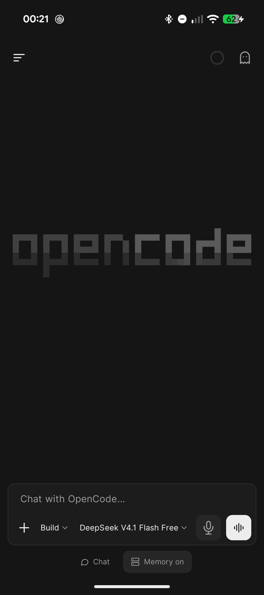
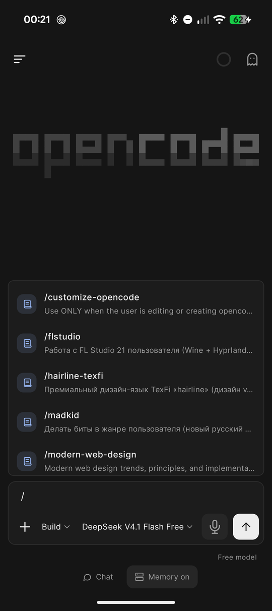
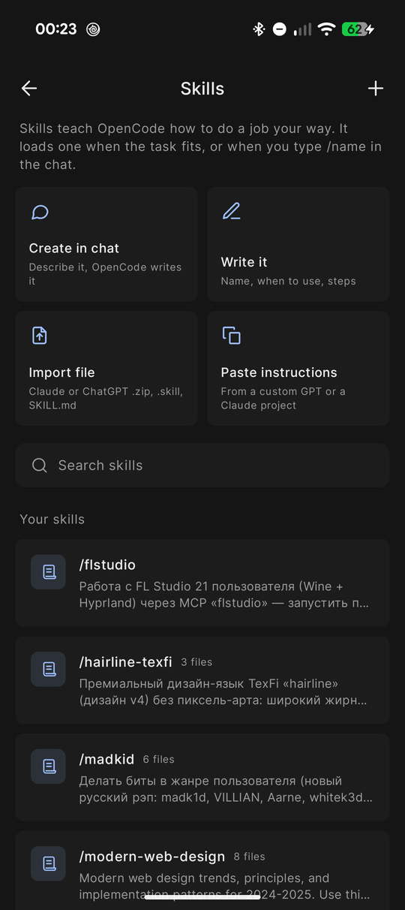
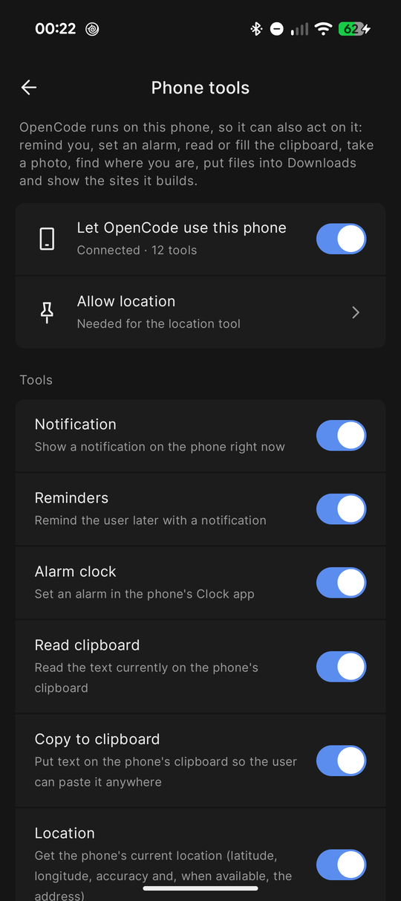
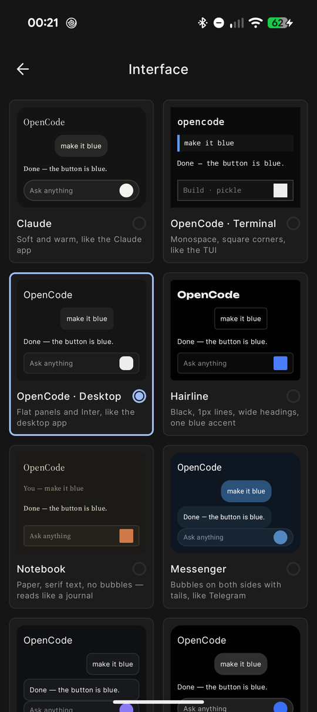
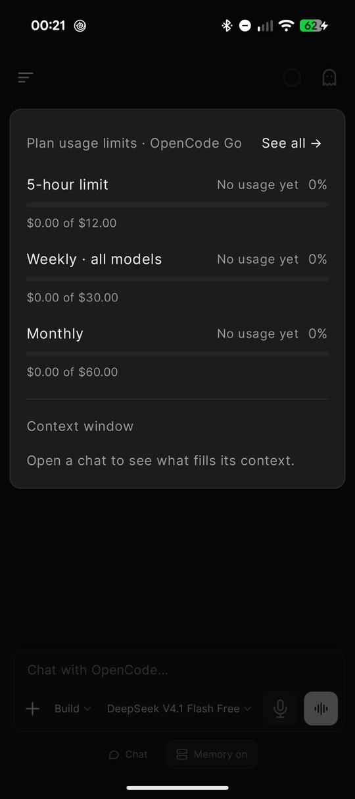
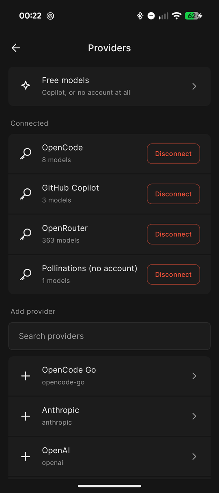

# OpenCode mobile

An Android app that runs its own OpenCode server on the phone. It unpacks Ubuntu 24.04 in proot (no root), starts `opencode serve` on 127.0.0.1 and gives it a mobile UI. You don't need a computer, but you can also connect to OpenCode running on one.

Current version: **v0.0.1 beta-3**. Android 8+, arm64. Unofficial client.

<p align="center">
  
  
  
  
  
</p>

## Features

**Skills.** Type `/` in the chat to pick a skill or command. Skills are regular `SKILL.md` folders, so you can import the ones you use in Claude or ChatGPT (.zip, .skill or SKILL.md), paste the instructions of a custom GPT or a Claude project, or ask the agent to write a new skill in the chat.

**GitHub.** Sign in once with a device code. The app installs git and the GitHub CLI in Ubuntu and sets git to your name and noreply email. After that the agent can clone, commit, push and open pull requests as you. It is told never to add Co-Authored-By or other AI attribution.

**Phone tools.** The app exposes an MCP server to the agent, so it can show notifications, set reminders and alarms, read and fill the clipboard, take a photo, get your location, save files to Downloads and share them. Each tool can be switched off. Sites the agent builds open in a live preview inside the app.

**Usage.** A ring in the top bar shows the 5-hour, weekly and monthly limits you set, and what fills the context window (system prompt, tools, MCP, skills, memory, messages). The composer can show an estimated cost before you send.

**Interrupted tasks.** If Android kills the server in the middle of a task, the chat offers Continue or Cancel when you come back. Progress can also be shown on the lock screen, with Allow and Deny buttons for permission requests.

**Interfaces.** Several looks to choose from in Settings, including OpenCode Desktop and OpenCode Terminal. The app icon can follow the look.

**Memory.** The agent keeps facts in markdown files under `/root/memory` and sorts them by topic. You can view and edit them in Settings → Memory.

**Models.** OpenCode Zen and Go (sign in from the app), the free models, GitHub Copilot, Pollinations without an account, or your own key for any provider OpenCode supports.

**Updates and backup.** The app checks GitHub releases and installs updates with one tap. Settings → Backup & move saves chats, sign-ins, memory, skills, projects and settings into one file you can restore on another phone.

<p align="center">
  
  
</p>

## Install

1. Download the APK from [Releases](../../releases) and install it. Android will ask you to allow installs from this source.
2. On first launch the app downloads Ubuntu Base and OpenCode, so you need internet and free space.
3. Pick a model. The free Zen models share a limit that the OpenCode service counts on its side. When it runs out, the app offers other free options.

Next updates arrive inside the app.

This is a beta and there are bugs. Please report them in [Issues](../../issues).

## How it works

- `runtime/` downloads and unpacks the rootfs and OpenCode and runs them through proot (taken from Termux, shipped as `libproot.so` in `jniLibs`). `ServerService` is a foreground service that keeps the server alive.
- `api/` is a REST and SSE client for OpenCode 1.x.
- `data/` holds chat state from SSE, the model catalog, usage tracking, memory, skills, GitHub sign-in, the phone MCP server (`PhoneBridge`), backup and updates.
- `ui/` contains the Compose screens. Looks are defined in `ui/theme/Looks.kt`.
- `tools/promo/` has the scripts that render the promo video and banners.

OpenCode is pinned to 1.19.4 (`RuntimeController.OC_VERSION`), the version the client is tested against.

`targetSdk` is 28 on purpose: from 29 on, Android does not allow running binaries from the app's data directory, and proot needs that (Termux does the same). For the same reason the app is distributed as an APK and not through Google Play.

## Build

```
./gradlew :app:assembleDebug
```

JDK 21 is required. Release builds are made by GitHub Actions when a `v*` tag is pushed (`.github/workflows/release.yml`).

## Not tested yet

Phones other than a Pixel, Android 14–16 on other firmware, light themes of every look, Copilot on paid plans, and restoring a backup on a different phone.

## License

The app's own code is MIT (see `LICENSE`).

OpenCode mobile is an unofficial client and is not affiliated with the OpenCode developers. "OpenCode" is the name of their project (MIT). The app includes proot and libtalloc from Termux (GPL-2.0 / LGPL-3.0), whose sources are in the Termux project, and downloads Ubuntu Base 24.04 and OpenCode on first launch. Those components keep their own licenses. Fonts: Inter, Source Serif 4, Unbounded and JetBrains Mono, all SIL OFL 1.1.
